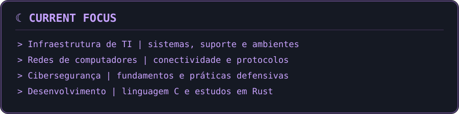
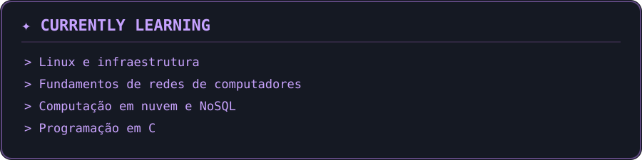
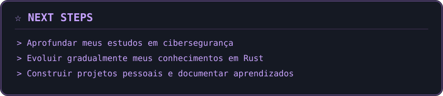

<!-- Midnight Tech | Privacy First -->

# ☾ Hello, I'm Danieli!

**IT Infrastructure Intern · Systems Development Student**

`Linux` · `Networking` · `Cybersecurity` · `C` · `Rust (learning)`

Sou formada em **Gestão da Tecnologia da Informação** e atualmente curso **Análise e Desenvolvimento de Sistemas**. Atuo como estagiária na área de **Infraestrutura de TI**, aprofundando meus conhecimentos em tecnologia, redes e sistemas.

Tenho interesse em **Linux, infraestrutura, cibersegurança e desenvolvimento de software**. Este espaço reúne minha evolução acadêmica e projetos pessoais independentes.

  

*Learning quietly. Building consistently. ☾*

